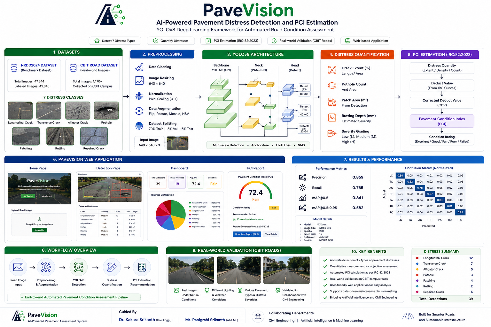
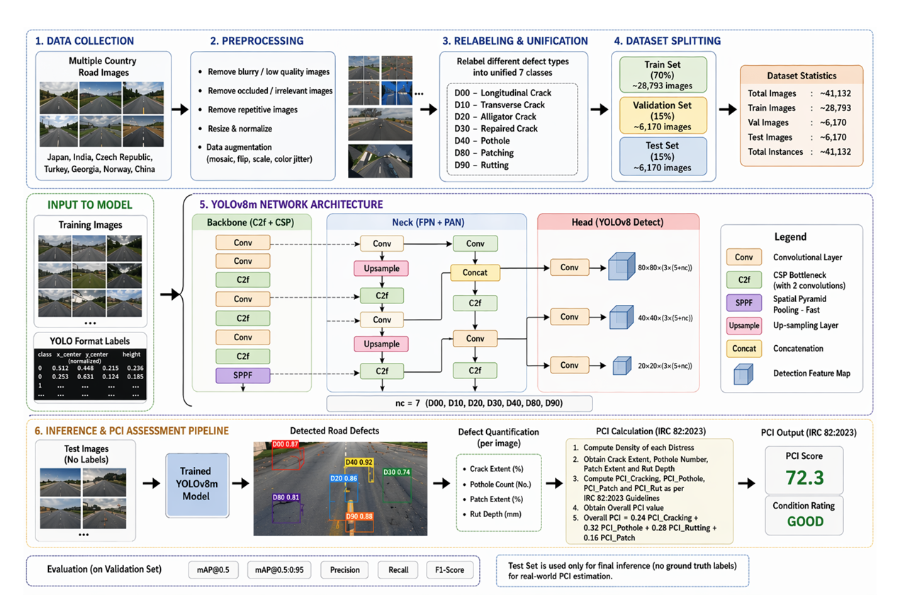
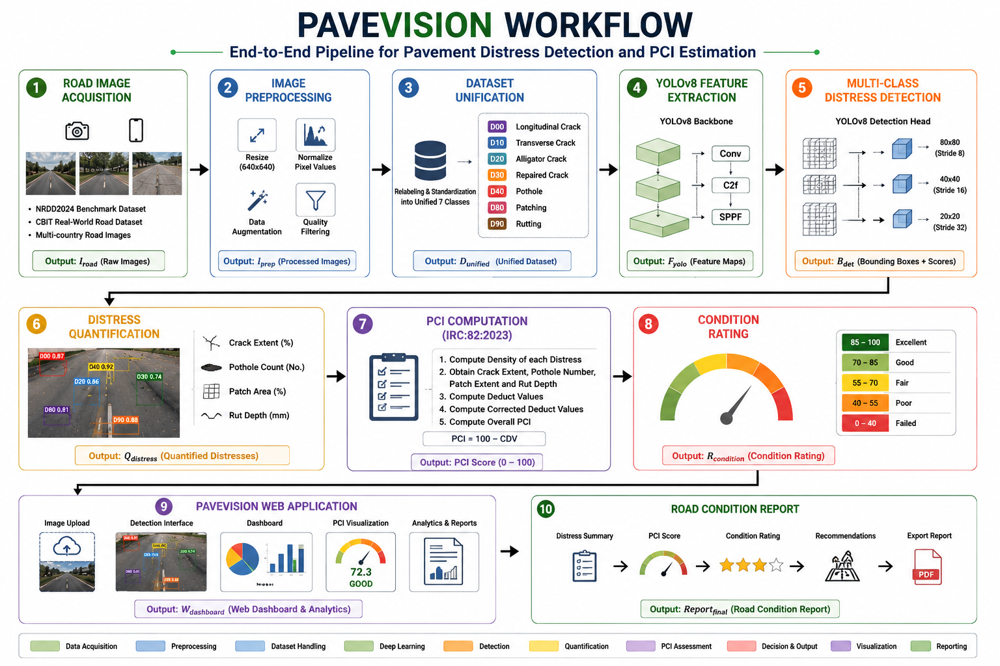
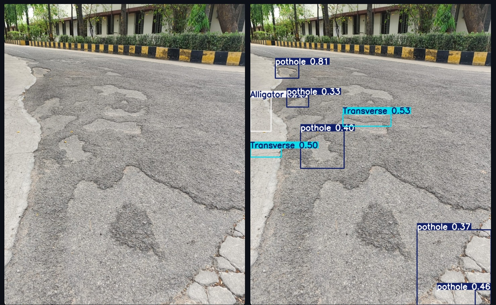
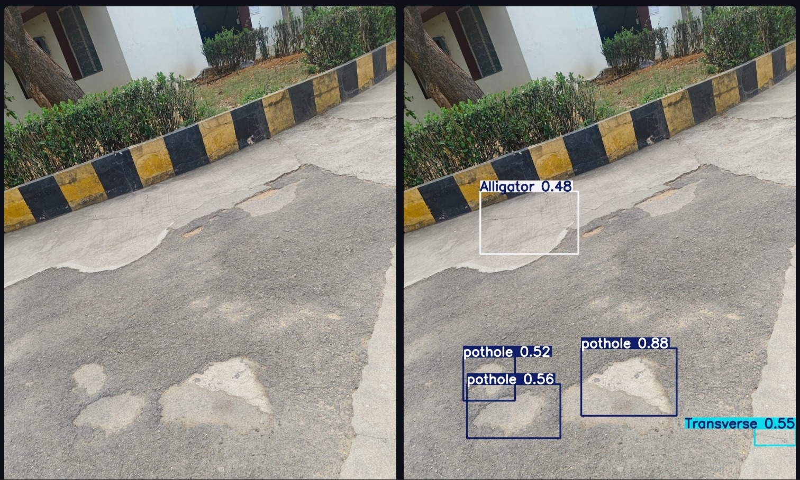

<h1 align="center">Deep Learning-Based Pavement Distress Detection & PCI Estimation</h1>

<p align="center">
  <strong>Automated Road Condition Assessment Using YOLOv8m and IRC:82:2023 Guidelines</strong>
</p>

<p align="center">
  B.E. Final-Year Thesis • Department of Civil Engineering, CBIT Hyderabad • <strong>First Position (Best Project, 2025–26)</strong>
</p>

<p align="center">
  
  
  
  
  
</p>

<p align="center">
  
</p>

---

## Overview

This repository contains the implementation of our B.E. Civil Engineering thesis: **Deep Learning-Based Identification, Classification, and Quantification of Distress in Flexible Pavements Using YOLOv8 for Automated Road Condition Assessment and PCI Estimation**.

The framework integrates a **YOLOv8m** object detection pipeline with civil engineering quantification and **Pavement Condition Index (PCI)** formulations based on **IRC:82:2023** guidelines. It detects seven flexible pavement distress classes, converts bounding-box detections into engineering quantities via geometric scaling, and computes weighted PCI scores for Highway, MDR/Rural, and Urban roads.

In addition to benchmark evaluation on a class-balanced subset of the multi-country **N-RDD2024** dataset, the framework was externally validated on real-world road imagery collected from the Chaitanya Bharathi Institute of Technology (CBIT) campus, and paired with **RoadAI**, a local web prototype for image upload, detection visualization, and PCI reporting.

---

## Proposed Architecture & Workflow

<p align="center">
  
</p>

<p align="center">
  
</p>

---

## Key Features

- **Automated Distress Detection:** YOLOv8m-based identification and localization across 7 flexible pavement distress categories.
- **Engineering Quantification:** Geometric scaling of detections into Crack Extent (%), Pothole Number, Patch Extent (%), and estimated Rut Depth (mm).
- **IRC:82:2023 PCI Estimation:** Empirical component-wise PCI formulations for Highway, MDR/Rural, and Urban road categories using a weighted-index approach.
- **External Field Validation:** Tested on unseen, real-world road imagery from CBIT campus roads under varied lighting and surface conditions.
- **RoadAI Prototype Interface:** Local web application prototype for image upload, bounding-box visualization, automated PCI reports, and analytics dashboards *(currently local / not yet deployed)*.

---

## Distress Categories

| Class Code | Distress Type      |
| ---------- | ------------------ |
| D00        | Longitudinal Crack |
| D10        | Transverse Crack   |
| D20        | Alligator Crack    |
| D30        | Repaired Crack     |
| D40        | Pothole            |
| D80        | Patching           |
| D90        | Rutting            |

---

## Methodology

### 1. Dataset Preparation
- **Benchmark Dataset:** Multi-country **N-RDD2024** road damage dataset.
- **Preprocessing:** Class-balanced training set preparation to address under-represented distress classes, image cleaning, resizing to 640 x 640, normalization, and data augmentation (flipping, scaling, color jitter, mosaic).

### 2. Detection Model (YOLOv8m)
- **Backbone:** C2f feature extraction network with SPPF module.
- **Neck:** PAN-FPN multi-scale feature fusion.
- **Head:** Anchor-free decoupled detection head.

### 3. Distress Quantification & PCI Estimation (IRC:82:2023)
Detected bounding boxes are converted into measurable engineering quantities over the total surveyed area ($A = N \times L \times W$):
- **Crack Extent (CE)** (%)
- **Pothole Number (PN)**
- **Patch Extent (PaE)** (%)
- **Average Rut Depth (RD)** (mm)

Individual PCI components (PCI<sub>Cracking</sub>, PCI<sub>Pothole</sub>, PCI<sub>Rutting</sub>, PCI<sub>Patch</sub>) are computed using IRC:82:2023 empirical relationships for the selected road category (Highway, MDR/Rural, or Urban), and combined into an overall weighted PCI:

**Overall PCI = 0.24 × PCI<sub>Cracking</sub> + 0.32 × PCI<sub>Pothole</sub> + 0.28 × PCI<sub>Rutting</sub> + 0.16 × PCI<sub>Patch</sub>**

---

## Validation Performance (YOLOv8m)

Evaluated on the validation set (1,795 images; 5,498 instances):

| Class              | Images | Instances | Precision | Recall | mAP@0.5 | mAP@0.5:0.95 |
| ------------------ | ------ | --------- | --------- | ------ | ------- | ------------ |
| **All Classes**    | **1795** | **5498**  | **0.859** | **0.765** | **0.841** | **0.582**    |
| Longitudinal Crack | 280    | 395       | 0.798     | 0.658  | 0.783   | 0.492        |
| Transverse Crack   | 407    | 714       | 0.837     | 0.692  | 0.821   | 0.442        |
| Alligator Crack    | 157    | 2971      | 0.912     | 0.910  | 0.965   | 0.708        |
| Repaired Crack     | 15     | 22        | 1.000     | 0.121  | 0.343   | 0.243        |
| Pothole            | 353    | 597       | 0.885     | 0.871  | 0.931   | 0.587        |
| Patching           | 491    | 674       | 0.921     | 0.912  | 0.958   | 0.619        |
| Rutting            | 92     | 125       | 0.823     | 0.904  | 0.927   | 0.747        |

> **Note:** The model achieves **mAP@0.5 > 0.92** for alligator cracks, potholes, patching, and rutting. Lower recall on repaired cracks is due to limited sample availability (22 instances) in the validation split.

---

## CBIT Campus Real-World Validation

To evaluate generalization beyond benchmark datasets, an independent set of road images was collected from the Chaitanya Bharathi Institute of Technology (CBIT) campus under natural driving, lighting, and surface conditions.

### Sample Validation Results

<p align="center">
  
</p>

<p align="center">
  
</p>

> **Note:** These images were independently collected from CBIT campus roads and were not part of the original N-RDD2024 benchmark dataset. They were used to evaluate the real-world generalization and field applicability of the proposed YOLOv8m pavement distress detection framework.

These results demonstrate the ability of the trained YOLOv8m framework to identify multiple pavement distress types in previously unseen road environments.

---

## RoadAI Prototype Web Interface

A prototype web interface (**RoadAI**) was developed to demonstrate end-to-end usability, supporting:
- Road image upload and automated YOLOv8m distress detection
- Bounding-box visualization with confidence scores
- Automated IRC:82:2023 PCI score and condition rating generation
- Analytics dashboard for distress and severity distributions

*(Prototype runs locally; not yet deployed to production.)*

---

## Repository Structure

```text
Deep-Learning-Based-Pavement-Condition-Index-Estimation/
├── assets/                     # Architecture diagrams and CBIT validation outputs
├── codes/
│   ├── Road AI Backend/        # Backend API for the RoadAI local prototype
│   ├── website Road AI/        # Frontend web interface for RoadAI
│   ├── code.ipynb              # YOLOv8m training and evaluation notebook
│   └── pci_estimation.py       # Geometric distress quantification & IRC:82:2023 PCI script
├── models/                     # Trained YOLOv8m model weights
├── .gitignore
├── README.md
├── requirements.txt            # Python dependencies
└── setup.py                    # Package setup script
```

---

## Project Team

Developed at **Chaitanya Bharathi Institute of Technology (Autonomous), Hyderabad** through an interdisciplinary collaboration between the Departments of Civil Engineering and Artificial Intelligence & Machine Learning.

| Name | Role | Department |
| ---- | ---- | ---------- |
| **Paidimarri Sri Vinya Manju Bhargavi** | Team Lead | Civil Engineering |
| **Koyyadi Sathwik** | Co-Author | Civil Engineering |
| **Manoj Kumar Sunkara** | Collaborator | Artificial Intelligence & Machine Learning |

### Contributions

#### Civil Engineering Team
- Problem formulation, pavement distress taxonomy, and IRC:82:2023 PCI methodology
- Class-balanced N-RDD2024 dataset preparation, cleaning, and geometric scaling for distress quantification
- YOLOv8m model training, validation evaluation, and engineering performance analysis
- CBIT campus field image collection and real-world validation
- Contribution to RoadAI prototype workflow and final thesis documentation

#### AI & ML Collaborator
- Deep learning pipeline optimization support
- RoadAI local web interface and analytics dashboard development

---

## Guidance

### Thesis Supervisor (Guide)
**Dr. Kakara Srikanth**  
Assistant Professor, Department of Civil Engineering  
Chaitanya Bharathi Institute of Technology (A), Hyderabad

### Co-Guide
**Mr. Panigrahi Srikanth**  
Assistant Professor, Department of Artificial Intelligence & Machine Learning  
Chaitanya Bharathi Institute of Technology (A), Hyderabad

---

## Recognition

- **First Position (Best Project)** among all major projects in the Department of Civil Engineering, CBIT (Batch 2022–2026), awarded after external examiner evaluation.

---

## License

This repository is intended for academic and research purposes.  
Copyright © 2026.
